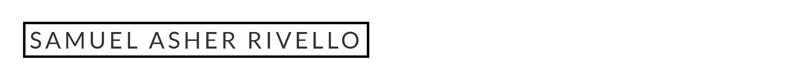
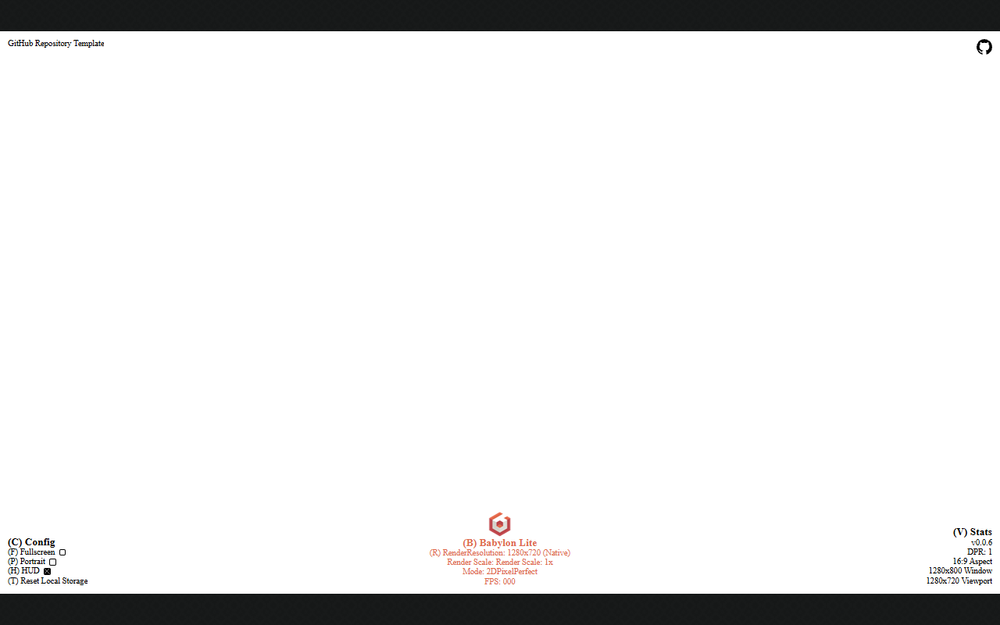

<!-- AI: Keep commands rooted at the repository. The Vite application, source, tests, and build output belong in wordle-clone/. -->
<a href="docs/samuel-asher-rivello-banner.png"></a>
<BR>

[](https://github.com/SamuelAsherRivello/babylon-lite-wordle-game-clone/actions)
[](LICENSE)
[](https://github.com/Fission-AI/OpenSpec)
[](https://react.dev/)
[](https://www.typescriptlang.org/)
[](https://vite.dev/)

# Candordle

An original, tactile five-letter word game with accessible controls, local progress, and three replayable puzzle modes.

## Original AI Prompt

<details>
<summary>Read the full original prompt</summary>

```text
Create an original single-player Wordle-style word game named “Wordle Clone.”

Core loop: six attempts to guess a five-letter English word; clear correct/present/absent states; physical and accessible on-screen keyboard input; common plurals and past tenses including -ed forms, BROKE, and AROSE are valid.

Modes: Classic, Speed Wordle with a visible countdown, and Two-Guess Challenge.

Add optional themes, an obscure crossword-style clue, and earned non-spoiler hints. Use an original warm, tactile, rounded visual language inspired only by the reference image's broad mood and color palette. Do not copy its gameplay, text, assets, layouts, branding, or puzzles.

Persist local progress and settings. Build with React, TypeScript, Vite, and Babylon Lite where appropriate; add focused deterministic tests, GitHub Pages readiness, and documentation.
```

</details>

## Live Demo

- [Play Candordle](https://samuelasherrivello.github.io/babylon-lite-wordle-game-clone/)

## Images

<a href="docs/screenshot01.png"></a>

## Table of Contents

1. [Getting Started](#getting-started)
2. [Project Details](#project-details)
3. [Credits](#credits)

## Getting Started

Install dependencies, run the browser game locally, and use the verified commands below for checks and production builds.

### 🛠 Build Project

1. From the repository root, run `npm install`.
2. Run `npm run build` to run source coverage, type checks, tests, and the static Vite build.

### 🛠 Run Project

1. From the repository root, run `npm run dev` and open the localhost URL Vite prints.
2. Use letters, Enter, and Backspace, or the focusable on-screen keyboard, to play.

### 🛠 Release Version

1. Run `npm test` and `npm run build` from the repository root.
2. Push to `main` to deploy through the GitHub Pages workflow.
3. Run the **Release** workflow from GitHub Actions to bump the patch version, tag it, and create the GitHub release.

## Project Details

Candordle is a responsive, portrait-first browser puzzle with local-only data and an original warm-paper puzzle style.

### 🤖 AI

- [AI Overview](docs/ai-overview.md) describes the repository's AI resources.

### 🧠 Deep Dive

- [Deep Dive Overview](docs/deep-dive-overview.md) summarizes technical details for developers.

### 📦 Packages

- [React](https://react.dev/) renders the accessible game interface.
- [TypeScript](https://www.typescriptlang.org/) keeps game rules and UI strict.
- [Vite](https://vite.dev/) provides local development and static production builds.

### 📝 Structure

- `docs/` contains canonical README images and project documentation assets.
- `wordle-clone/src/game/` contains deterministic word rules, modes, and lexicons.
- `wordle-clone/src/` contains the React interface and game styles.
- `wordle-clone/test/` contains focused deterministic game-rule tests.

### 🎮 Play Details

- Classic provides six guesses; Speed Wordle adds a visible 60-second countdown; Two-Guess Challenge ends after two guesses and starts with an answer-specific challenge clue.
- A build-time MIT English-word source is trimmed to 12,653 five-letter words only; ordinary plurals, regular past tenses, `BROKE`, and `AROSE` are accepted.
- Optional themes, crossword-style clues, and placed-letter progress unlock one non-spoiler hint.
- Settings persist locally and include hard mode, optional clues, sound, personal progress, and release notes.

## Credits

### 💡 Contributors

- Samuel Asher Rivello - Over 25 years of game development XP (2026)

### 💡 Contact

- [LinkedIn.com/in/SamuelAsherRivello](https://Linkedin.com/in/SamuelAsherRivello) ⭐
- [GitHub.com/SamuelAsherRivello](https://github.com/SamuelAsherRivello/)
- [Twitter.com/srivello](https://twitter.com/srivello/)
- Resume / Portfolio: [SamuelAsherRivello.com](http://www.SamuelAsherRivello.com)

### 💡 License

- Provided as-is under the [MIT License](LICENSE).
- Copyright © 2026 Rivello Multimedia Consulting, LLC.
