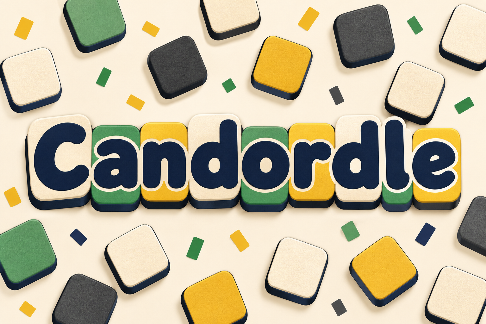

# Candordle branding



Official name: **Candordle**.

## Art direction

Warm cream, dark navy lettering and tactile rounded tiles in green, yellow and charcoal echo the game's panels and word feedback.

The existing output/candordle-playing-670x1076.png capture, wordle-clone/src/app.tsx and wordle-clone/src/style.css establish the current tile layout, rounded geometry and palette. The screenshot was viewed for visual context only. The final image was generated from a text prompt without supplying, cropping, tracing or compositing a screenshot.

## Asset and usage

- File: `docs/images/game-logo.png`.
- Purpose: README splash illustration and game-directory thumbnail.
- Generation: built-in OpenAI image generation through the existing Codex session. No API key, separately billed API or external image service was used.
- Format: opaque PNG, 1536 by 1024 pixels.
- Keep the complete title visible when displaying or resizing the image. The official name excludes "Multiplayer"; multiplayer capability remains documented separately where applicable.

## Final generation prompt

```text
Use case: logo-brand. Create a completely original landscape 3:2 splash illustration from scratch for the word puzzle "Candordle". Exact title and only readable text: "Candordle", spelled C-a-n-d-o-r-d-l-e. The full title is the dominant central element in one line, dark ink navy rounded chunky lettering on a warm cream field; its baseline is supported by tactile rounded square tiles with green and mustard accent faces. Give the lettering a small solid offset navy shadow like printed cut paper, never obscure any letter. Surround the title with a loose playful scattering of blank rounded letter-game tiles, some green, some ochre yellow, some charcoal with ivory faces, and small confetti rectangles. No words on those surrounding tiles. An inviting original graphic illustration, flat shapes with tactile paper texture, controlled physical shadows, friendly rounded geometry and a warm minimalist tabletop feel, excellent readability at 240px width. The actual game uses cream panels, bold navy outlines and shadows, rounded tiles, green/yellow/charcoal feedback and a simple accessible keyboard. Use only this visual vocabulary, do not depict a screenshot or game screen. No HUD, no copied layout or reference logo, no brand other than the title, no watermark, no extra text, never Multiplayer. Safe margins, opaque cream background.
```
